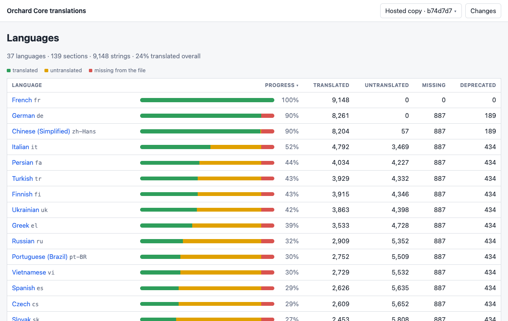

# Orchard Core Translations

[](https://github.com/OrchardCMS/OrchardCore.Translations/actions/workflows/stage.yml)

Orchard Core translations provide two kinds of NuGet packages:

- __Culture Specific Packages__: A NuGet package that targets a single culture, named `OrchardCore.Translations.{culture}.nupkg` where `{culture}` is the culture it contains.
- __Translations Meta Package__: A NuGet package named `OrchardCore.Translations.All.nupkg` which references the cultures selected for inclusion in the meta package.

Crowdin Translations: 

[](https://crowdin.com/project/orchard-core)

## Translation editor

The translation editor is a web app for translating Orchard Core directly in this
repository:

**<https://orchardcms.github.io/OrchardCore.Translations/>**

[](editor/README.md)

It shows the translation status of every language and edits the `.po` files section
by section: untranslated strings, plural forms, strings a file is missing, and
strings that are no longer in the templates. Only the lines you change are rewritten.

To contribute translations with it:

1. Open the editor, pick your language, then a section, and translate.
2. Move your changes into a clone of this repository, in one of two ways:
   - **Local folder** (Chrome or Edge): open your clone from the editor and save;
     the `.po` files are edited in place.
   - **Patch** (any browser): download a patch from the editor's *Changes* page and
     apply it with `git apply --3way`.
3. Commit on a branch and open a pull request. The [owners of the language](#language-owners)
   are asked to review it.

The [editor guide](editor/README.md) explains each step with screenshots, how to run
the editor locally (`dotnet run editor/site.cs -- serve`), and how it is tested and
deployed.

## Language owners

A language owner reviews the translations of one language. GitHub automatically
requests their review on every pull request that changes files in
`Localization/<culture>/`, including the pull requests opened by Crowdin. Owners are
listed, one line per language, in [`.github/CODEOWNERS`](.github/CODEOWNERS). A
language can have several owners, and a language without a line has no automatic
reviewer.

### Becoming a language owner

1. Open a pull request that adds your GitHub username to the line of your language in
   [`.github/CODEOWNERS`](.github/CODEOWNERS), or adds a line if the language has
   none, keeping the lines sorted by culture:

   ```text
   /Localization/it/ @your-github-username
   ```

2. In the description, say which language you want to own and mention your previous
   translation contributions, if any.
3. A maintainer reviews the request. GitHub only accepts code owners who have write
   access to the repository, so the maintainer grants it to you when merging.

### Stepping down

Open a pull request that removes your username from
[`.github/CODEOWNERS`](.github/CODEOWNERS), or ask a maintainer in an issue. When you
are the only owner of a language, remove its whole line. Maintainers may also remove
an owner who no longer responds to review requests.

## Catalogs, cultures, and packages

`Localization/*.pot` contains the English source catalogs copied from Orchard
Core by the [Sync POT files workflow](.github/workflows/sync-pot.yml).
Translated catalogs live in `Localization/<culture>/*.po`. Crowdin
synchronizes the source catalogs and proposes translation updates through GitHub
pull requests, using the integration configuration in [`crowdin.yml`](crowdin.yml).
Repository-side translation edits must also be imported into Crowdin; ensure the
integration is configured to import new translations, or upload them explicitly.
Exporting translations from Crowdin is not a substitute for importing those edits.

[`cultures.json`](cultures.json) controls packaging, not Crowdin's language mapping.
[`pack.ps1`](pack.ps1) reads each culture's settings:

| Setting | Purpose |
|---|---|
| `name` | Culture suffix of the NuGet package and culture folder inside that package. |
| `folder` | Source folder under `Localization` from which to copy the PO files. |
| `display-name` | Human-readable language name used in package metadata. |
| `generate-package` | Whether to build the culture-specific package. |
| `meta-package` | Whether to include that package as a dependency of `OrchardCore.Translations.All`. |

All three packaging workflows call `pack.ps1`: pull requests build packages,
pushes to `main` or `dev` publish `4.0.0-preview-*` packages to Cloudsmith, and version tags
or a manual release run publish stable packages to NuGet.org. Packaging copies
the selected catalogs; it does not translate them or reconcile duplicate folders.

### Chinese cultures

Maintain only two Chinese source folders, matching Crowdin's current output:
`Localization/zh-Hans` for Simplified Chinese and `Localization/zh-Hant` for
Traditional Chinese. The culture mappings generate four packages:

| Package suffix | Source folder | Folder inside the package |
|---|---|---|
| `zh-Hans` | `Localization/zh-Hans` | `content/Localization/zh-Hans` |
| `zh-CN` | `Localization/zh-Hans` | `content/Localization/zh-CN` |
| `zh-Hant` | `Localization/zh-Hant` | `content/Localization/zh-Hant` |
| `zh-TW` | `Localization/zh-Hant` | `content/Localization/zh-TW` |

The regional packages intentionally reuse the corresponding script-level
translations. Separate `Localization/zh-CN` and `Localization/zh-TW` source folders
are unnecessary and are not read by packaging. Update `zh-Hans` or `zh-Hant`
directly, including when generating AI-assisted translations; do not recreate
the historical regional folders.

## AI-assisted translations

The repository includes the
[`orchardcore-translations` skill](.github/skills/orchardcore-translations/SKILL.md)
for generating translation batches and safely importing their JSON responses.
It fills only missing translation values, preserves populated translations, and
removes obsolete entries from the selected culture without changing POT files or
other cultures. Review AI-generated translations before merging them.

Generated prompts include POT translator notes, format argument names, and
inclusive plural count ranges. Each PO file keeps its own valid `Plural-Forms`
rule, rather than being automatically migrated to Orchard Core's CLDR 49
fallback. Existing headerless plural catalogs require a separate review and
migration before generating or importing translations; `--plural-forms` supplies
rules only for new catalogs. Merge relevant **Sync POT files** updates before
relying on new source metadata.

In the Copilot app, select the **Orchard Core translator** custom agent, or ask:

> Use the orchardcore-translations skill to complete French translations in
> Localization/fr, with 200 translation values per batch. Locate the Orchard Core
> source checkout before generating prompts.

In IDEs that support Copilot prompt files, use **`/translate-culture`**. The skill
is also discoverable automatically by compatible Copilot clients. Prompt files
are IDE entry points, not Copilot app suggested-prompt configuration.

The full translation workflow requires the Copilot app's coordinated chat-session
tools so each batch inherits the caller's model and effort settings. Other
clients can generate prompts and import completed JSON responses using the
bundled scripts, but should not silently substitute another dispatcher. To
generate prompts without changing catalogs, explicitly request "generate prompts
only." All generation requires a separate, readable
`OrchardCMS/OrchardCore` source checkout for translation context, Python 3.10 or
later, and the dependency in
[requirements.txt](.github/skills/orchardcore-translations/scripts/requirements.txt).
The agent asks for missing inputs, including the batch size, before generating.
Keep generated artifacts outside this repository.

Run the skill's regression tests from the repository root:

```shell
python3 -m pip install -r .github/skills/orchardcore-translations/scripts/requirements.txt
python3 -m unittest discover -s .github/skills/orchardcore-translations/scripts -p 'test_*.py'
```

## Automatic POT Updates

The [**Sync POT files**](.github/workflows/sync-pot.yml) GitHub Actions workflow runs every Monday at 03:00 UTC and
can also be started manually using **Run workflow** in the Actions tab. It clones
the `main` branch of `OrchardCMS/OrchardCore`, replaces `Localization/*.pot` with
the upstream templates (including removing obsolete templates), and creates or
updates a pull request if Git detects changes. Translated `.po` files are not changed.

The repository's **Settings > Actions > General > Workflow permissions** must
allow GitHub Actions to create pull requests. The workflow uses `GITHUB_TOKEN`
with write permissions for repository contents and pull requests.

## Release Walkthrough

The following steps are needed to release new Orchard Core Translations NuGet packages:

1. In GitHub's Actions tab, select **Sync POT files** and click **Run workflow**
   on `main`, or use the latest scheduled run.
2. Review and merge the resulting **Update POT files from Orchard Core** pull
   request, if there are changes. This copies the upstream POT files directly;
   no local source checkout or extraction tool is needed.
3. Go to https://crowdin.com/project/orchard-core.
4. Go to Integrations > GitHub and click **Sync Now** to synchronize the updated
   source catalogs, then complete any missing translations in Crowdin.
5. Sync again to export translations and find the **New Crowdin updates** pull
   request at https://github.com/OrchardCMS/OrchardCore.Translations/pulls.
6. Review and merge it.
7. Push a new version tag to this repository, such as `v3.0.0`, to publish stable
   packages, or run **Publish Stable Packages** manually with the desired version.
