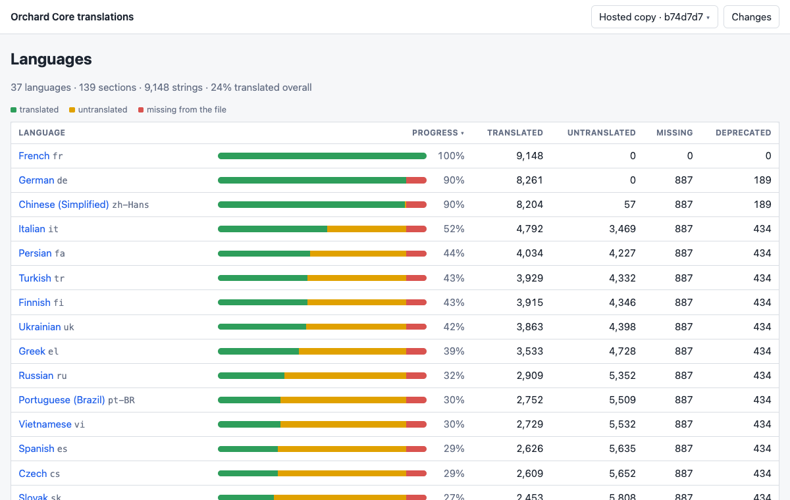
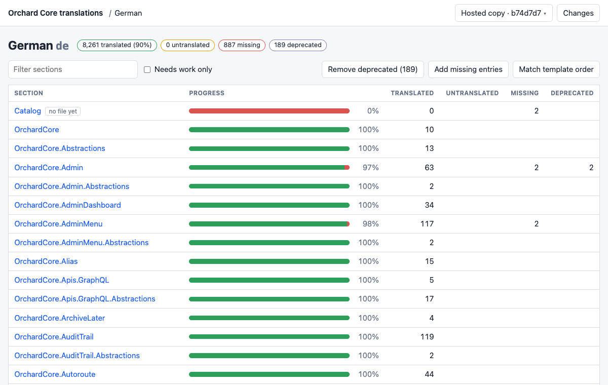
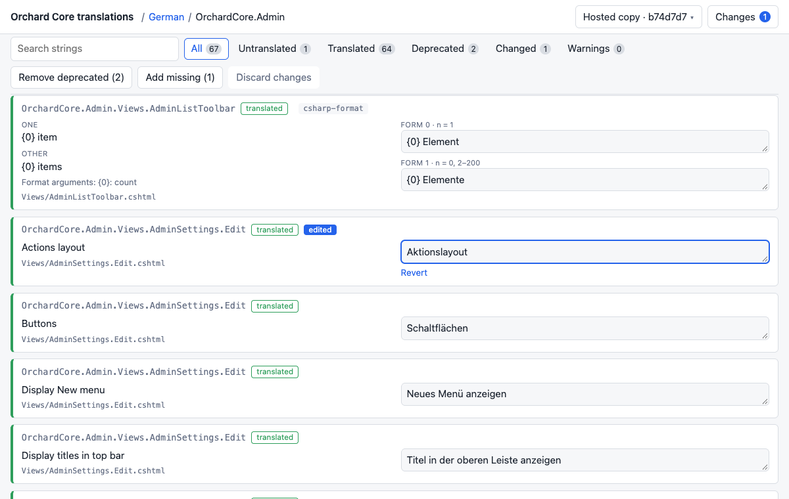
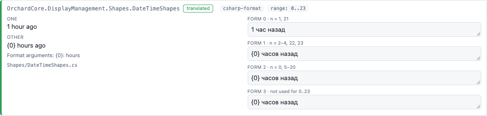
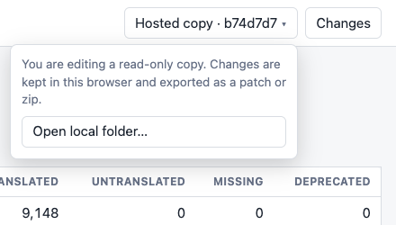
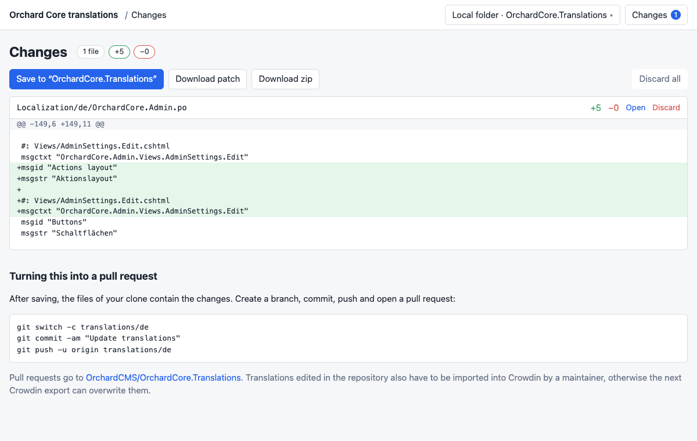
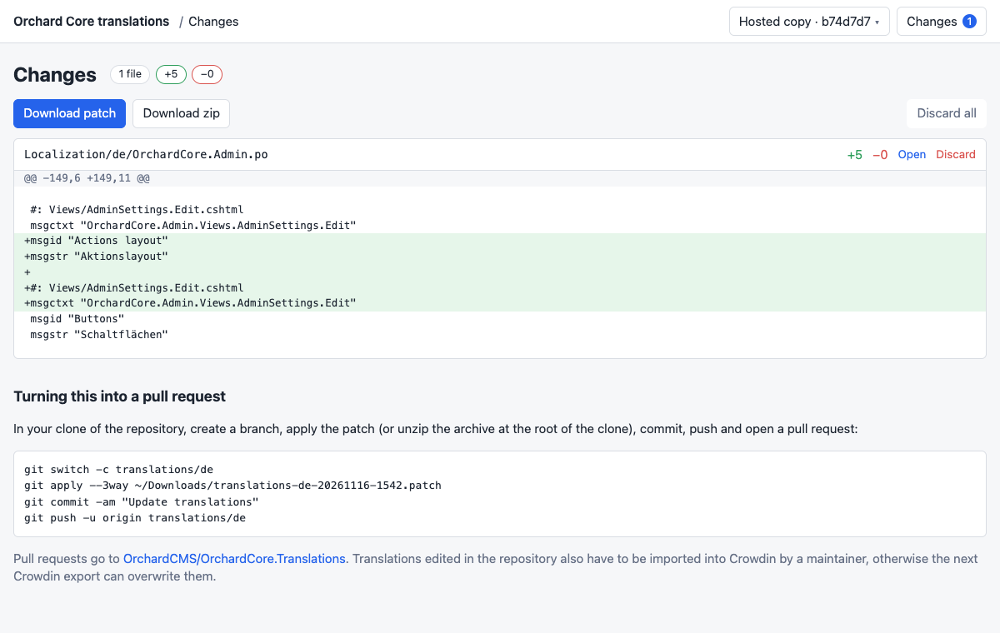

# Translation editor

A web app for translating Orchard Core. It shows the translation status of every
language and lets you edit the `.po` files of this repository section by section,
without disturbing the lines you did not change.

**Online:** <https://orchardcms.github.io/OrchardCore.Translations/>

The online editor always shows the catalogs of the `main` branch. It is rebuilt
whenever they change.

- [Finding what needs translating](#finding-what-needs-translating)
- [Editing a section](#editing-a-section)
- [Getting your changes into a pull request](#getting-your-changes-into-a-pull-request)
  - [Option A: edit your local clone directly](#option-a-edit-your-local-clone-directly)
  - [Option B: export a patch or a zip](#option-b-export-a-patch-or-a-zip)
- [Running the editor locally](#running-the-editor-locally)
- [Questions and problems](#questions-and-problems)
- [For developers](#for-developers)

## Finding what needs translating

The first page lists every language with its progress. Click a column header to
sort.



Each string of a language is in one of these states:

| State | Meaning |
|---|---|
| **Translated** | The string has a translation. |
| **Untranslated** | The string is in the `.po` file with an empty translation, or a plural with only some forms filled. |
| **Missing** | The string is in the template (`.pot`) but not in the `.po` file yet. It is added to the file when you translate it. |
| **Deprecated** | The string is in the `.po` file but no longer in the template. Orchard Core does not use it any more. |

Click a language to see its sections. A section is one `.pot` file, usually one
Orchard Core module. Tick *Needs work only* to hide the sections that are complete.



## Editing a section

Click a section to edit its strings. The source text is on the left, the translation
on the right. Above the source is its context, which tells where the string is used.



- **Filters** show only the untranslated, translated, deprecated or changed strings,
  or the ones with a warning. **Search** looks in source texts, translations and
  contexts.
- A string you changed is marked **edited**. *Revert* puts back what the file has.
- **Warnings** point out a translation whose placeholders (`{0}`, `{1}`…) or
  leading/trailing spaces differ from the source. Spaces, tabs and line breaks at the
  edges of the source text are drawn as `·`, `→` and `↵`.
- *Copy source* starts from the English text. When the same English text is already
  translated elsewhere in the file, *Use “…”* offers that translation.
- `Ctrl+Enter` (`⌘+Enter` on macOS) moves to the next translation.
- **Deprecated** strings cannot be edited, only removed.

Your edits are saved in the browser as you type. Nothing is written to a file or sent
anywhere until you save or export them from the **Changes** page.

### Plural forms

A string with a plural shows one field per plural form of the language. Each field
says which numbers use it, following the `Plural-Forms` rule of the file. When the
template restricts the numbers (`range: 0..23` for hours, for instance), the examples
are limited to that range.



Fill in every form, including one marked *not used*: a string counts as translated
only when all its forms have a value.

### Bulk helpers

The buttons next to the filters apply to the whole section. The first three are also
on the language page, where they apply to every existing file of the language.

| Button | Effect |
|---|---|
| **Remove deprecated** | Removes every deprecated string. |
| **Add missing** | Adds the strings the file lacks, with an empty translation, so the file lists everything the template has. |
| **Match template order** | Shown when a file's strings are not in the template's order. Reorders them. |
| **Discard changes** | Forgets your pending changes for the section. |

Before removing deprecated strings, check whether one of them is an older wording of
an untranslated string: its translation is often a good starting point.

## Getting your changes into a pull request

The **Changes** page lists the files you changed with their differences. Click a file
to see its diff.

Changes always end up in a pull request against this repository. If you have not
contributed before, [fork the repository](https://github.com/OrchardCMS/OrchardCore.Translations/fork)
and clone your fork first. There are two ways to move your edits from the editor into
your clone.

### Option A: edit your local clone directly

This needs Chrome or Edge. The editor reads and writes the `.po` files of your clone.

1. In your clone, create a branch:

   ```bash
   git switch -c translations/de
   ```

2. Open the editor (online or [locally](#running-the-editor-locally)). In the source
   menu at the top right, choose **Open local folder…** and pick the folder of your
   clone. The browser asks you to allow the site to edit the files of that folder.

   

   The menu now reads *Local folder* and the statistics are those of your branch.

3. Translate.

4. Open **Changes**, review, and click **Save to “…”**. The `.po` files of your
   clone are updated.

   

5. Check the result, commit and push:

   ```bash
   git diff
   git commit -am "Update German translations"
   git push -u origin translations/de
   ```

6. Open a pull request on GitHub.

The browser remembers the folder: next time, the source menu offers to reopen it.

### Option B: export a patch or a zip

This works in any browser. You edit the online copy, and apply the result to your
clone afterwards.

1. Open the [online editor](https://orchardcms.github.io/OrchardCore.Translations/)
   and translate. The source menu shows which commit of `main` you are editing.

2. Open **Changes**, review, and click **Download patch**.

   

3. In your clone, start from an up-to-date `main`, create a branch and apply the
   patch:

   ```bash
   git switch main
   git pull
   git switch -c translations/de
   git apply --3way ~/Downloads/translations-de-20261116-1457.patch
   ```

   `--3way` lets git merge your changes when the files have changed since you
   downloaded the patch.

4. Commit, push and open a pull request:

   ```bash
   git commit -am "Update German translations"
   git push -u origin translations/de
   ```

**Download zip** is an alternative to the patch. The archive contains the complete
changed files; unzip it at the root of your clone to replace them. Because it replaces
whole files, only use it on a branch that is up to date with `main`.

Your edits stay in the browser after an export, so you can keep translating and
export again. Once your pull request is merged and the online editor is rebuilt, the
edits that are now in the files disappear from **Changes** by themselves.

### After the pull request

- GitHub asks the [owners of the language](../README.md#language-owners), if it has
  any, to review the pull request.
- Translations edited in the repository also have to be imported into Crowdin by a
  maintainer, otherwise the next Crowdin export can overwrite them (see the main
  [README](../README.md#catalogs-cultures-and-packages)).

## Running the editor locally

You only need this to work offline or to change the editor itself. It requires the
.NET 10 SDK or later.

```bash
dotnet run editor/site.cs -- serve
```

Open <http://localhost:5080/>. The editor then shows the catalogs of your checkout
instead of `main`. The local server only reads them: to edit, use **Open local
folder…** as in option A, or export a patch as in option B. Use `--port` to listen on
another port.

## Questions and problems

**Where are my edits kept?** In the local storage of your browser, for the site you
are using. They survive closing the tab, but not clearing the site's data, and they
are not shared between browsers or computers. Export a patch if you need to move
them.

**A string says “file changed since your edit”.** The file received another
translation for that string after you edited it, for instance from Crowdin. Hover the
mark to see the file's value. Your version is the one that gets saved; use *Revert*
to keep the file's.

**The patch does not apply.** Make sure your branch starts from a recent `main` and
that you used `git apply --3way`. If git reports conflicts, resolve them like any
merge conflict, keeping one `msgstr` per string.

**“Open local folder…” is missing.** Firefox and Safari cannot write to local
folders. Use Chrome or Edge, or export a patch.

**Can I edit the English text?** No. The `.pot` files come from Orchard Core's source
code; change the text there.

**What exactly does the editor write?** Only the lines you change. Header order,
comments, line endings and the end of each file stay as they were. New strings are
copied from the template and inserted at the template's position. Strings are never
wrapped. Removing every string of a file leaves its header.

## For developers

### Tests

The tests check that every `.pot` and `.po` file of the repository can be read and
written back byte for byte, that edits only touch the expected lines, and that the
statistics computed by `site.cs` match the editor's own.

- In the browser: <http://localhost:5080/tests.html>
- From a terminal (needs Node, no packages):

  ```bash
  dotnet run editor/site.cs -- build --out _site
  node editor/wwwroot/tests/run-node.mjs --index _site/data/index.json
  ```

### Layout

| Path | Purpose |
|---|---|
| `site.cs` | File-based C# app: `serve` for local use, `build` to produce the static site with its statistics index (`data/index.json`). |
| `wwwroot/js/po.js` | Lossless PO parser and serializer. |
| `wwwroot/js/catalog.js` | Merges a template with a translation file, computes statistics, applies pending changes. |
| `wwwroot/js/plurals.js` | `Plural-Forms` parser and evaluator. |
| `wwwroot/js/sources.js` | Hosted copy and local folder access. |
| `wwwroot/js/drafts.js` | Pending changes in local storage. |
| `wwwroot/js/diff.js`, `zip.js` | Patch and zip export. |
| `wwwroot/js/views/` | Dashboard, language, section editor and changes pages. |
| `wwwroot/tests/` | Tests, runnable in the browser and in Node. |
| `docs/` | Screenshots used by this guide. |

The editor is plain HTML, CSS and JavaScript modules: there is no build step and no
npm package.

### Deployment

[`pages.yml`](../.github/workflows/pages.yml) builds the site, runs the tests and
deploys to GitHub Pages on every push to `main` that touches the catalogs or the
editor. Pull requests that touch them run the build and the tests only.
